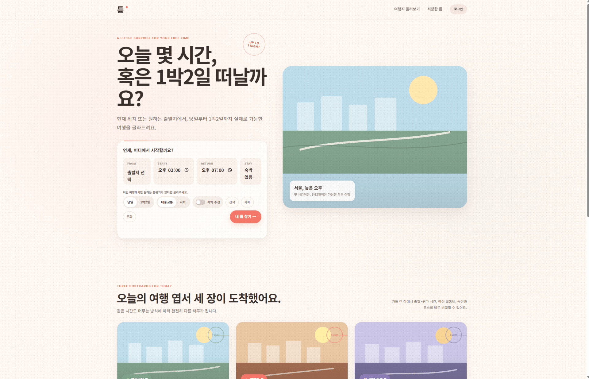
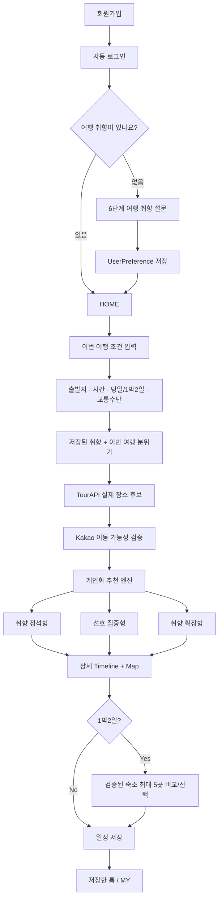
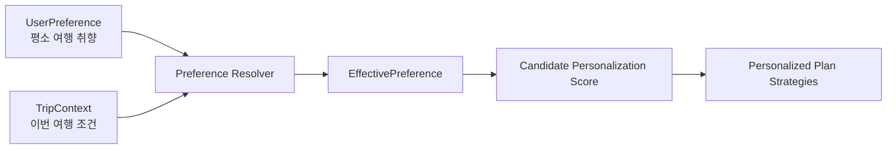
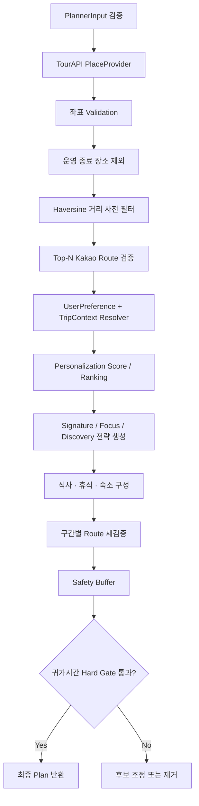
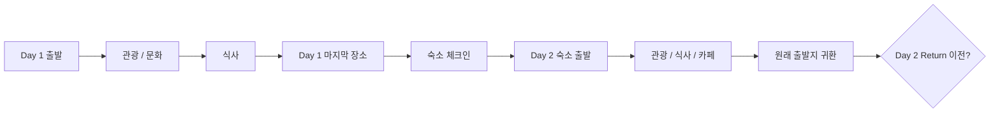
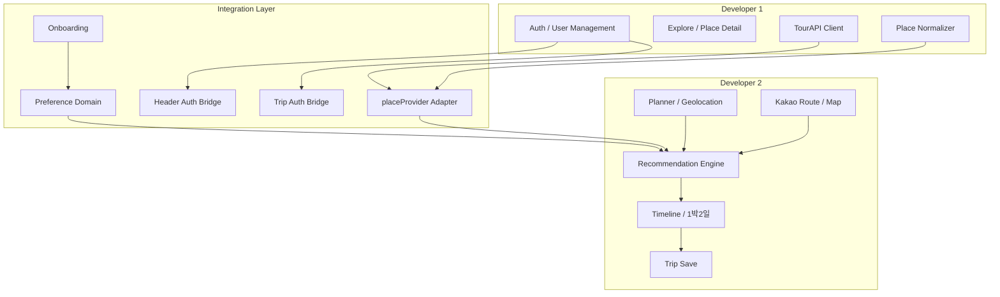
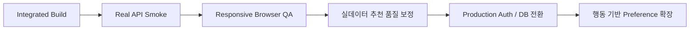

<div align="center">

# 틈 TEUM

### 하루에 여행 하나쯤.

**사용자의 여행 취향과 지금의 위치·시간·이동 조건을 결합해,  
실제로 다녀올 수 있는 개인화 여행 일정을 생성하는 여행 추천 서비스**


</div>

---

## 1. TEUM은 어떤 서비스인가요?



여행 추천 서비스는 많지만, **지금 가진 시간 안에 실제로 다녀올 수 있는 일정**을 만들어 주는 서비스는 생각보다 많지 않습니다.

TEUM은 단순히 인기 장소를 나열하지 않습니다.

- 사용자가 **평소 어떤 여행을 좋아하는지** 최초 설문으로 저장하고
- 매 여행마다 **출발지·시간·기간·교통수단** 같은 현재 조건만 입력하면
- 한국관광공사 **TourAPI 실제 관광 데이터**와 **Kakao 이동 경로**를 이용해
- 운영시간·이동시간·귀가시간 같은 현실 제약을 먼저 검증한 뒤
- 사용자 취향을 서로 다른 방향으로 해석한 **3개의 개인화 일정**을 제공합니다.

> **취향에 맞는가?** 보다 먼저 **실제로 갈 수 있는가?**를 확인하고,  
> 그 안에서 가장 나다운 여행을 추천하는 것이 TEUM의 핵심입니다.

---

## 2. 서비스 한눈에 보기

| 영역 | 주요 기능 |
| --- | --- |
| 👤 회원 | 회원가입, 로그인/로그아웃, 마이페이지, 회원 탈퇴 |
| 🧭 취향 온보딩 | 가입 후 최초 1회 6단계 여행 취향 설문 |
| 📍 출발지 | 현재 위치, 지역·장소 검색, 빠른 위치, 좌표 입력 |
| ⏰ 여행 조건 | 당일 / 1박2일, 시작·귀가 시각, 대중교통 / 자차 |
| 🧠 개인화 추천 | 장기 취향 + 이번 여행 분위기 + 실제 이동 가능성 결합 |
| ✨ 추천 3안 | 취향 정석형 / 선호 집중형 / 취향 확장형을 사용자별 동적 생성 |
| 🗺 실제 장소 | TourAPI 관광·음식·숙박·문화·행사·코스·쇼핑 데이터 |
| 🚗 이동 검증 | Kakao 대중교통 / 자동차 경로, 실패 구간 fallback 및 diagnostics |
| 🏨 1박2일 | Day 1 → 숙소 → Day 2 구조, 숙소 최대 5곳을 실제 일정에 대입 검증 |
| 🗺 지도 | 일정 장소 마커, 마커 클릭 상세 정보, Kakao 지도 연결 |
| 💾 저장 | 로그인 사용자별 일정 저장/조회/삭제 |

---

## 3. 사용자 흐름



---

## 4. 개인화의 핵심: 장기 취향과 이번 여행 조건을 분리

TEUM은 사용자의 모든 정보를 하나의 입력값으로 섞지 않습니다.

### Long-term Preference

회원가입 후 최초 설문에서 저장되는 비교적 안정적인 여행 취향입니다.

- 자연 / 맛집 / 카페 / 문화·전시 / 역사
- 쇼핑 / 사진·전망 / 로컬·골목 / 체험·액티비티
- 여행 페이스: 느긋하게 ↔ 꽉 채우기
- 이동 허용도
- 걷기 선호도
- 유명 명소 ↔ 숨은 장소
- 실내 ↔ 야외
- 조용함 ↔ 활기참
- 맛집 / 카페 / 휴식 중요도

### Trip Context

현재 여행에만 적용되는 조건입니다.

- 출발지
- 시작 시각 / 귀가 시각
- 당일 / 1박2일
- 대중교통 / 자차
- 이번 여행의 분위기(예: 산책, 카페, 문화)

현재 분위기 선택은 장기 취향 자체를 바꾸지 않고 **이번 추천에만 Temporary Override**로 적용됩니다.



---

## 5. 고정된 3안이 아닌, 사용자의 취향에서 나온 3안

기존의 고정된 `여유로운 / 빽빽한 / 랜덤` 구분은 사용하지 않습니다.

세 일정은 모두 **사용자가 설문에서 선택한 pace와 휴식 성향을 공유**하며, 차이는 일정의 밀도를 억지로 바꾸는 것이 아니라 **취향을 해석하는 방식**입니다.

| 전략 | 역할 | 예시 |
| --- | --- | --- |
| **Signature · 취향 정석형** | 상위 취향을 가장 안정적으로 반영 | 🌿 느긋한 취향 코스 |
| **Focus · 선호 집중형** | 상위 1~2개 선호를 더 선명하게 반영 | ☕ 카페 · 문화 중심 코스 |
| **Discovery · 취향 확장형** | 핵심 취향을 유지하며 2차 선호와 새로운 장소를 제한적으로 탐색 | ✨ 여유로운 발견 코스 |

예를 들어 사용자가 **느긋한 일정 + 높은 휴식 중요도 + 카페/문화/로컬 선호**라면 세 안 모두 느긋한 페이스를 유지합니다.

```text
🌿 느긋한 취향 코스
☕ 카페 · 문화 중심 코스
✨ 여유로운 발견 코스
```

즉 두 번째 카드라는 이유만으로 갑자기 빽빽한 일정이 되지 않습니다.

> 기존 저장 데이터와 deep-link 호환성을 위해 내부 `plan.type`의 `slow / full / random` ID는 유지하지만,  
> 사용자 화면에서는 `strategyLabel / strategyTag / strategyTagline`을 사용합니다.

---

## 6. 추천 엔진은 어떻게 동작하나요?



### Hard Constraint

취향보다 항상 우선합니다.

- 유효하지 않은 좌표
- 운영 종료 장소
- 실제 이동 불가능 경로
- 숙박 조건 불충족
- 최종 귀가시간 초과

### Soft Preference

Hard Constraint를 통과한 장소 사이에서 순위를 조정합니다.

- 카테고리 취향
- 이번 여행 분위기
- 이동 거리 선호
- 숨은 장소 선호
- 실내/야외 선호
- 조용함/활기 선호
- 음식·카페·휴식 중요도

---

## 7. 1박2일 여행

1박2일은 단순히 당일 일정을 길게 늘리지 않습니다.



숙소는 단순 추천 목록이 아닙니다.

1. 주변 숙박 후보 조회
2. `Day 1 마지막 장소 → 숙소` 이동시간 계산
3. 숙소 체크인 가능 시각 검증
4. `숙소 → Day 2 첫 장소` 동선 재계산
5. Day 2 전체 Timeline 재생성
6. 최종 귀가시간 Hard Gate 재검증
7. 모든 조건을 통과한 숙소만 최대 **5곳** 노출

따라서 화면에 나타난 숙소는 모두 **현재 일정에 실제 반영 가능한 숙소**입니다.

---

## 8. Dev1 + Dev2 통합 아키텍처



### Developer 1 범위

- **F101** 지역별 관광지
- **F102** 관광 / 숙박 / 음식
- **F103** 문화 / 행사 / 코스 / 쇼핑
- TourAPI `detailCommon2 + detailIntro2`
- **F107** 회원관리
- **F108** 로그인 / 로그아웃

### Developer 2 범위

- Planner / Geolocation
- 당일 / 1박2일
- Kakao Route / Map
- Recommendation Engine
- Timeline
- 숙소 일정 검증
- 일정 저장 / 삭제

### Integration에서 추가된 영역

- Dev1 `placeProvider` → Dev2 Recommendation 연결
- Auth 사용자 ID → 저장 일정 `ownerUserId` 연결
- 최초 여행 취향 Onboarding
- UserPreference / Resolver / Personalization Scoring
- 사용자 설문 기반 3개의 동적 추천 전략
- MyPage 여행 취향 수정
- Navigation 통합

---

## 9. 실제 장소 데이터

Recommendation은 더 이상 Mock 데이터를 기본으로 사용하지 않습니다.

```js
import { placeProvider } from './js/integration/placeProvider.js';
```

`placeProvider`는 Dev1의 TourAPI 클라이언트를 기반으로 다음 계약을 제공합니다.

```text
getRegions
getSubregions
searchPlaces
getNearbyPlaces
getPlaceDetail
getFoodCandidates
getLodgingCandidates
```

추천 엔진은 TourAPI 원본 응답을 직접 읽지 않고 아래와 같은 **normalized Place Contract**만 사용합니다.

```js
{
  id,
  contentId,
  contentTypeId,
  type,
  title,
  address,
  lat,
  lng,
  imageUrl,
  tel,
  categoryPath,
  overview,
  openInfo,
  raw
}
```

이 구조 덕분에 외부 API 형식과 Recommendation Domain을 분리할 수 있습니다.

---

## 10. 주요 페이지

| 페이지 | 역할 |
| --- | --- |
| `index.html` | Home + Planner + 이번 여행 조건 입력 |
| `onboarding.html` | 최초 6단계 여행 취향 설문 |
| `result.html` | 사용자 취향 기반 3개 추천 일정 |
| `detail.html` | Timeline, Kakao Map, 장소/숙소 상세, 일정 저장 |
| `saved.html` | 현재 사용자 저장 일정 조회/삭제 |
| `explore.html` | TourAPI 기반 여행지 탐색 |
| `place.html` | 관광지 상세 정보 |
| `signup.html` | 회원가입 |
| `login.html` | 로그인 |
| `mypage.html` | 계정 정보 + 여행 취향 확인/수정 |

---

## 11. 기술 스택

| 구분 | 기술 |
| --- | --- |
| Frontend | HTML5, CSS3, Vanilla JavaScript ES Modules |
| Local Runtime | Node.js local server / REST proxy |
| 관광 데이터 | 한국관광공사 TourAPI |
| 지도 | Kakao Maps JavaScript SDK |
| 위치/검색 | Kakao Map & Local REST API |
| 이동 | Kakao 대중교통 / 자동차 경로 API |
| Auth Demo | LocalStorage 기반 Front-end Auth |
| Preference | LocalStorage `teum.user_preferences.v1` |
| Trip Save | LocalStorage `teum.trips.v1` |
| QA | Node assert 기반 Domain / Integration tests + Smoke tests |

> 현재 Auth는 프론트엔드 데모용입니다. 실제 운영 서비스에서는 서버 인증과 안전한 사용자 저장소로 교체해야 합니다.

---

## 12. 프로젝트 구조

```text
TEUM_INTEGRATED_READY/
├── index.html
├── onboarding.html
├── result.html
├── detail.html
├── saved.html
├── explore.html
├── place.html
├── signup.html
├── login.html
├── mypage.html
│
├── css/
│   ├── style.css                 # 공통 디자인 토큰 / frozen
│   └── pages/
│       ├── planner.css
│       ├── result.css
│       ├── detail.css
│       ├── saved.css
│       ├── explore.css
│       ├── auth.css
│       └── onboarding.css
│
├── js/
│   ├── api/
│   │   ├── tourApi.js
│   │   ├── kakaoMap.js
│   │   └── kakaoRoute.js
│   │
│   ├── core/
│   │   ├── authStorage.js
│   │   ├── geolocation.js
│   │   ├── http.js
│   │   └── tripStorage.js
│   │
│   ├── features/
│   │   ├── auth/
│   │   ├── explore/
│   │   ├── onboarding/
│   │   ├── planner/
│   │   ├── preferences/
│   │   │   ├── defaultPreference.js
│   │   │   ├── preferenceSchema.js
│   │   │   ├── preferenceResolver.js
│   │   │   ├── preferenceScoring.js
│   │   │   └── preferenceStorage.js
│   │   ├── recommendation/
│   │   │   ├── generatePlans.js
│   │   │   ├── personalizedStrategies.js
│   │   │   ├── routeCache.js
│   │   │   └── ...
│   │   └── timeline/
│   │
│   ├── integration/
│   │   ├── placeProvider.js
│   │   ├── headerAuth.js
│   │   └── tripAuthBridge.js
│   │
│   └── pages/
│       ├── homePage.js
│       ├── resultPage.js
│       ├── detailPage.js
│       ├── savedPage.js
│       ├── explorePage.js
│       ├── placePage.js
│       ├── authPage.js
│       └── onboardingPage.js
│
├── scripts/
│   ├── setup-integrated-keys.ps1
│   ├── integration-check.mjs
│   ├── kakao-smoke.mjs
│   └── tourapi-smoke.mjs
│
├── tests/
│   ├── dev2.test.js
│   ├── integration.test.js
│   └── auth-preference.test.js
│
└── docs/
    └── Dev1 integration / QA documents
```

---

## 13. 로컬 실행

### 요구사항

- Node.js **18+ 권장**
- Kakao Developers 앱
- 공공데이터포털 한국관광공사 TourAPI Decoding Key

별도의 npm 패키지 의존성이 없기 때문에 현재 통합본은 `npm install` 없이 실행할 수 있습니다.

### 1) API Key 설정

VSCode PowerShell에서:

```powershell
Set-ExecutionPolicy -Scope Process Bypass
.\scripts\setup-integrated-keys.ps1
```

순서대로 입력합니다.

```text
Kakao REST API key
Kakao JavaScript key
TourAPI Decoding key
```

로컬에 생성되는 파일:

```text
.env.local
js/config/keys.local.js
```

> **실제 API Key는 Git/ZIP에 포함하지 않습니다.**

### 2) 전체 자동 검사

```powershell
npm run check
```

### 3) 로컬 서버 실행

```powershell
npm run dev
```

브라우저:

```text
http://localhost:4173/index.html
```

### 4) 외부 API Smoke Test

새 터미널에서:

```powershell
npm run smoke:kakao
npm run smoke:tour
```

---

## 14. 테스트 명령

```powershell
# 통합 정적 검사 + 전체 테스트
npm run check

# Dev1 Place Normalizer
npm run test:dev1

# Dev2 Planner / Recommendation / Timeline
npm run test:dev2

# Provider + Preference Integration
npm run test:integration

# Auth + Preference + 사용자별 저장 일정
npm run test:auth-preference

# Kakao 실제 연결
npm run smoke:kakao

# TourAPI 실제 연결
npm run smoke:tour
```

### 자동 검증 항목

- Dev1 / Dev2 ownership collision
- frozen `css/style.css` hash
- JS / MJS syntax
- Place Normalizer fixture
- Planner validation
- 당일 / 1박2일 Recommendation
- 귀가시간 Hard Gate
- 숙소 일정 검증
- PlaceProvider Contract
- Preference normalization / resolver / scoring
- 느긋한 Preference → 3안 모두 relaxed 유지
- 고정 `빽빽 / 랜덤` 사용자 라벨 제거
- Auth + Preference + Trip ownership
- LocalStorage 손상 복구

---

## 15. 저장 구조

현재 Front-end demo는 다음 LocalStorage를 사용합니다.

```text
teum.users.v1             # 회원 목록
teum.session.v1           # 현재 로그인 세션
teum.user_preferences.v1  # 사용자별 여행 취향
teum.trips.v1             # 저장한 여행 일정
```

### 일정 소유 정책

```text
로그인 사용자 → ownerUserId = currentUser.id
비로그인       → ownerUserId = null
```

`saved.html`에서는 현재 사용자에게 해당하는 일정만 표시합니다.

회원 탈퇴 시 해당 사용자의 Preference와 저장 일정도 함께 정리합니다.

---

## 16. API 실패 시 동작

외부 API가 일부 실패해도 전체 서비스가 즉시 중단되지 않도록 설계했습니다.

### Route

```text
Kakao 실제 경로 성공
→ confirmed 이동시간 사용

일부 경로 실패
→ 허용된 거리 기반 estimated fallback
→ UI에 예상값임을 명시
```

도보 API가 특정 환경에서 HTTP 404를 반환하면 해당 실행에서는 반복 호출하지 않고 estimated fallback을 사용합니다.

### TourAPI

- 원본 필드 형식은 `placeNormalizer`에서 정규화
- 운영 상태를 확실히 알 수 없는 경우 임의로 영업중/종료를 추측하지 않고 `unknown` 유지
- 필요한 상세 텍스트는 Detail 단계에서 확인

---

## 17. 디자인

TEUM은 **POSTCARD STACK** 콘셉트를 기반으로 합니다.

- Warm Cream 기반 배경
- Paper Card 스타일
- 여행 사진 중심의 큰 카드
- Coral / Sage / Lavender 계열 포인트
- Desktop 3-card composition
- Mobile horizontal snap / responsive stack
- Detail에서는 **Timeline-first**, Map은 보조 정보
- 1박2일은 Day 1 / Stay / Day 2 계층을 명확하게 분리

공통 `css/style.css`는 통합 과정에서도 frozen 상태를 유지하고, 각 기능은 page-level CSS에서 확장합니다.

---

## 18. 현재 통합 상태

### 완료

- [x] Dev1 + Dev2 코드 병합
- [x] TourAPI 실제 PlaceProvider 연결
- [x] Kakao Map / Route 연결 구조
- [x] 회원가입 / 로그인 / 마이페이지
- [x] 최초 6-step Preference Onboarding
- [x] Preference 저장 / 수정
- [x] 장기 취향 + 이번 여행 조건 Resolver
- [x] 개인화 Candidate Ranking
- [x] 사용자 설문 기반 동적 추천 3안
- [x] 당일 / 1박2일
- [x] 일정 반영 가능한 숙소 최대 5곳
- [x] 마커 상세 정보
- [x] 사용자별 여행 저장
- [x] 자동 Domain / Integration QA

### 사용자 환경에서 최종 확인 필요

- [ ] 실제 Kakao Key `smoke:kakao`
- [ ] 실제 TourAPI Key `smoke:tour`
- [ ] 1440 / 1024 / 768 / 390 / 375 브라우저 시각 QA
- [ ] 실제 TourAPI 데이터 기반 광주/서울 추천 품질 최종 보정

---

## 19. Known Limitations

1. **Auth는 LocalStorage 기반 Front-end Demo**이며 실제 서버 인증을 대체하지 않습니다.
2. TourAPI list 데이터만으로 현재 영업 여부를 확정할 수 없는 경우 `openInfo.status = unknown`을 유지합니다.
3. `nature / local / photo` 같은 세밀한 취향은 현재 broad type + title/category/overview heuristic을 이용해 점수화합니다.
4. Walking API가 HTTP 404를 반환하는 환경에서는 거리 기반 예상값 fallback을 사용합니다.
5. 실 API Key가 패키지에 포함되지 않으므로 최종 Smoke/E2E는 각 개발 환경에서 수행해야 합니다.

---

## 20. 다음 단계



향후에는 명시적 설문뿐 아니라 사용자가 실제로 선택한 일정·숙소·저장 장소 같은 행동을 이용해:

```text
Explicit Preference
+
Implicit Behavior
```

구조로 확장할 수 있습니다.

단, 현재 MVP에서는 설명 가능한 **Rule + Weighted Score 기반 개인화**를 유지합니다.

---

## 21. 관련 문서

- [`INTEGRATION_REPORT.md`](./INTEGRATION_REPORT.md) — Dev1 + Dev2 통합 결과
- [`INTEGRATED_QA_CHECKLIST.md`](./INTEGRATED_QA_CHECKLIST.md) — 최종 QA 체크리스트
- [`RUN_INTEGRATED.md`](./RUN_INTEGRATED.md) — 통합 실행 가이드
- [`CHANGELOG_PERSONALIZED_3_PLANS.md`](./CHANGELOG_PERSONALIZED_3_PLANS.md) — 개인화 3안 변경 내역
- [`docs/DEV1_REPORT_FINAL.md`](./docs/DEV1_REPORT_FINAL.md) — Dev1 구현 결과
- [`DEV2_REPORT.md`](./DEV2_REPORT.md) — Dev2 구현 결과
- [`DEV2_FULL_QA_REPORT.md`](./DEV2_FULL_QA_REPORT.md) — Dev2 전수 QA

---

<div align="center">

### TEUM

**내 취향에 맞고, 지금 실제로 떠날 수 있는 여행.**

`TourAPI × Kakao × Personalized Recommendation`

</div>
